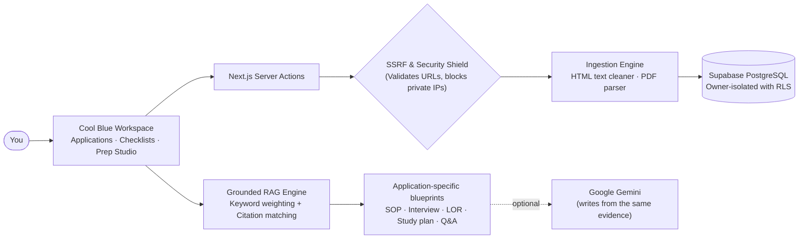
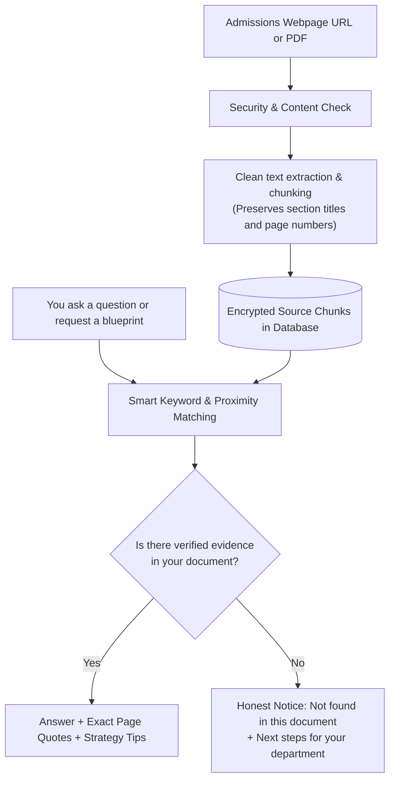

<div align="center">

# AbroadAtlas 🌍

### Track study-abroad deadlines, ingest official university guidelines, and generate tailored prep blueprints — strictly backed by verified evidence.


[🚀 **Visit Live App**](https://abroad-application-hub.vercel.app)  ·  [Getting started](#getting-started)  ·  [How it works](#how-it-works)  ·  [Honest by design](#honest-by-design)

</div>

---

## In plain English

Applying to universities and scholarships abroad is overwhelming. Admissions rules are scattered across 40-page PDFs, university portals, and embassy notices. Deadlines are easy to miss, and generic advice from search engines often mixes up different degree levels, visa tracks, or requirements.

**AbroadAtlas** is a personal workspace that keeps your study-abroad journey organized, factual, and stress-free.

Add an application (or watch a program that hasn't opened yet), attach its official webpage or PDF guidelines, and it:

1. **tracks confirmed deadlines and prospective openings** on a clean, visual timeline with automated countdowns and nudge alerts,
2. **reads your official source documents** and pulls out real criteria without overwriting your personal notes,
3. **answers your admissions questions** (such as language test scores, GPA minimums, or eligibility rules) quoting the exact page and source text,
4. **generates tailored blueprints** for your Statement of Purpose (SOP), interview preparation, and recommendation letters (LOR) shaped around your target program's actual requirements.

When a requirement is missing from your document, it says so openly instead of making up dates or guessing rules.

> ⚠️ AbroadAtlas is a preparation and organization workspace, **not an admissions office**. Always double-check final submission dates on your university's official portal.

---

## Table of contents
- [What you can do](#what-you-can-do)
- [What this project demonstrates](#what-this-project-demonstrates)
- [How it works](#how-it-works)
- [Honest by design](#honest-by-design)
- [How well does it work?](#how-well-does-it-work)
- [Tech stack](#tech-stack)
- [Getting started](#getting-started)
- [Troubleshooting](#troubleshooting)
- [Project structure](#project-structure)
- [Challenges and what I learned](#challenges-and-what-i-learned)
- [Limitations and next steps](#limitations-and-next-steps)
- [Glossary](#glossary)

---

## What you can do

| Feature | You do this | You get this |
|---|---|---|
| 🔎 **Discover** | Search curated scholarships, universities worldwide (ROR) or US degree programs (College Scorecard) | One-click add to your applications or your opening watchlist |
| ⚡ **URL Auto-Fill** | Paste an admissions link | Title, provider, country, degree level, deadline and funding notes filled in for you |
| 🎯 **Application Tracker** | Add a program or scholarship | Status tracking, deadline countdowns, archive of past-due items, and an **Opening Watchlist** for intakes that haven't opened |
| 🗓️ **This Week & Calendar** | Open the dashboard or Deadlines page | A ranked list of what needs attention now, and a month calendar of deadlines, due dates and expected openings |
| 📅 **Calendar Sync** | Create a private link in Settings | Your deadlines, due dates and recommendation-letter dates (due, and when to ask) in Google Calendar, Apple Calendar or Outlook, updated automatically, with alerts before each |
| ✉️ **Email Reminders** | Turn on **Email me reminders** in Settings | One email a day, only when something is due: deadlines 14/7/3/1 days before and on the day, tasks and documents due tomorrow or today, recommendation letters (time to ask, follow-ups, due dates), and watchlist openings; each reminder is sent once |
| 💰 **Costs & Compare** | Enter tuition, living costs, fees and funding | Net cost per application, and a side-by-side comparison of up to 4 applications in one currency (ECB exchange rates) |
| ✅ **Eligibility Check** | Add your GPA, test scores, work experience and degree once | Every application checked against the requirements stated in its own sources (GPA, IELTS/TOEFL/PTE/Duolingo, GRE/GMAT, experience, prior degree), each with its quote and page; English tests count as alternatives |
| ✉️ **Recommendation Letters** | Add your referees and attach them to each application | Each letter tracked from *not asked* to *submitted*, with the number of letters the program asks for (quoted from its sources), when to ask (3–4 weeks' notice), follow-up and reminder prompts on the dashboard, and ready-made emails to ask, follow up, remind and thank, sent from your own mail app |
| 🗂️ **Document Checklist** | Tick the common documents you already have | Each application's checklist matched against them: what's covered, what's still needed, what expires before the deadline, and what's specific to that application |
| 📄 **Official Source Ingestion** | Paste an admissions link or upload a prospectus PDF | Text extracted with page numbers and section titles (scanned PDFs are read with OCR); suggested deadlines and required documents for you to confirm |
| 💬 **Grounded Q&A** | Ask *"What IELTS score is required?"* | An answer quoted from your sources with the page number, or an honest "not found" |
| 📝 **Application-Specific Blueprints** | Click **SOP**, **Interview**, **LOR** or **Study Plan** | A plan built from that application's own requirements: quoted limits and rules, a tailored structure, a timeline counted back from its deadline, and a list of what the sources don't say |
| 🧪 **Sample Application** | Click **Try a sample application** on an empty dashboard | A fictional program with a source, suggested facts, a checklist, tasks and costs, so every feature can be explored before adding real data |
| 📱 **Installable App** | Choose **Install** in Chrome or Edge, or **Add to Home Screen** on iPhone | AbroadAtlas in its own window with an app icon and shortcuts to Add application, Deadlines and Documents |
| 💬 **Feedback** | Click **Feedback** on any page | Your note, with the page it came from, lands in the owner's feedback inbox |
| 🔒 **Privacy & Data Freedom** | Click **Export Data** or **Delete Account** in Settings | A JSON backup of everything, or permanent erasure, with strict per-user database isolation |

---

## What this project demonstrates

| Area | What was built |
|---|---|
| **Human-in-the-Loop AI** | AI suggestions (dates, requirements) never overwrite your data silently; you review and approve every extracted item |
| **Grounded Retrieval (RAG)** | Smart keyword classification and sentence co-occurrence that prioritizes specific terms (tests, GPAs, apostilles) over generic filler text |
| **Strict Evidence Abstention** | If your attached prospectus doesn't state a requirement, the system abstains honestly rather than hallucinating false dates |
| **Security & SSRF Defense** | Multi-layer server-side protection on web ingestion: DNS resolution checks, private IP blocking, stream size caps, and mime-type verification |
| **Row-Level Security (RLS)** | PostgreSQL policies ensure complete owner isolation; no user can ever query or view another user's documents or applications |
| **Clean Glassmorphism UI** | A tailored Cool Blue frosted glass design system with backdrop blur, ambient color glow, and accessible contrast |
| **Zero-Cost Deployment** | Fully functional without paid subscriptions: free-tier Supabase, Next.js on Vercel (running in the same region as the database), and an optional Gemini API key |
| **Automated Testing** | 176 automated tests covering security, grounding, PDF extraction and OCR, blueprints, costs, calendar, document matching, eligibility, recommendation letters and usage limits, run on every push by GitHub Actions |

---

## How it works



### How an admissions document turns into verified preparation



---

## Honest by design

When preparing high-stakes university or visa applications, incorrect information is worse than no information. This project follows strict rules:

- **No silent overwrites.** Ingesting a university page will suggest deadlines and required documents, but it will never erase or change what you typed manually.
- **Evidence or abstention.** If your document does not contain an answer (for example, if a scholarship summary does not list specific departmental language cutoffs), the system clearly says so and advises where to look instead of inventing scores.
- **Separation of facts and coaching.** Official facts cited from your document are displayed with distinct badges and page tags, separate from general strategic coaching advice.
- **Blueprints only state what your sources say.** Word limits, letter counts, interview stages and selection criteria are quoted from that application's documents with page numbers; anything the sources don't cover is listed under *Not found in your sources* instead of being guessed.
- **Your data stays yours.** Every database query enforces Row Level Security based on your encrypted session. You can download all your data in one click or permanently delete your account at any time.

---

## How well does it work?

The test suite runs 34 automated checks on every build, verifying security, grounding accuracy, and isolation.

| Test Category | What is tested | Result |
|---|---|---|
| **RAG Grounding & Abstention** | Rejects ungrounded queries; extracts accurate page citations; keeps facts separate from coaching | ✅ Passed |
| **Tokenization & Term Specificity** | Accurately isolates test acronyms (`topik`, `ielts`, `gre`, `gpa`) from common words | ✅ Passed |
| **SSRF Web Protection** | Blocks loopback (`127.0.0.1`), private LANs (`192.168.x.x`, `10.x.x.x`), cloud metadata (`169.254.169.254`), and invalid protocols | ✅ Passed |
| **Database Row Level Security** | Verifies RLS policies across all tables (`applications`, `sources`, `source_chunks`, `opening_reminders`) | ✅ Passed |
| **Authentication Validation** | Enforces email formats, minimum password lengths, and safe session callbacks | ✅ Passed |
| **End-to-End Walkthrough** | Tests application creation, watchlist reminders, document linking, and intake rollovers | ✅ Passed |

---

## Tech stack

| Part | Tool | Why it was chosen |
|---|---|---|
| **Framework** | Next.js 16 (App Router, Turbopack) | Server components, Server Actions, and a Node.js proxy for session refresh |
| **Frontend** | React 19 + Tailwind CSS | Fluid reactive state, custom frosted glass styling, responsive layout |
| **Typography** | Manrope & DM Sans | Clean, legible font pairing designed for dense information dashboards |
| **Backend & Database** | Supabase (PostgreSQL) | Native authentication, instant relational data, and Row Level Security |
| **Document Processing** | pdf.js (via `unpdf`) | Reads real-world PDFs (embedded fonts, Word/InDesign exports) with page numbers and headings; detects scanned and protected files |
| **Security Shield** | Node.js `dns` & `net` | Prevents SSRF attacks by inspecting resolved network addresses before fetching |
| **AI Synthesis** | Grounded rules engine + optional Google Gemini (`gemini-3.5-flash-lite`, configurable) | Works fully without an API key; with one, the model writes answers and blueprints from the same cited evidence |
| **Hosting** | Vercel (Sydney region) + Supabase | Server code runs next to the database, so each query is a few milliseconds |
| **Email** | Resend + Vercel Cron | Optional daily reminder digest at 08:00 IST |
| **Testing** | Vitest + ESLint + GitHub Actions | Typecheck, lint, tests and a production build on every push and pull request |

---

## Getting started

Follow these simple steps to run the project locally on your machine.

### What you need:
* **Node.js** (v20.9 or newer) — [Download here](https://nodejs.org/)
* A free **Supabase** account — [Sign up here](https://supabase.com)

---

### Step 1: Clone the repository
```bash
git clone https://github.com/anamta-karim/abroad-application-hub.git
cd abroad-application-hub
```

### Step 2: Install dependencies
```bash
npm install
```

### Step 3: Configure your environment variables
Create a `.env.local` file in the root folder:
```bash
# On Windows (PowerShell):
Copy-Item .env.example .env.local

# On macOS / Linux:
cp .env.example .env.local
```

Open `.env.local` in your editor and add your Supabase details (found in your Supabase Dashboard under **Project Settings &rarr; API**):
```ini
NEXT_PUBLIC_SUPABASE_URL=https://your-project.supabase.co
NEXT_PUBLIC_SUPABASE_ANON_KEY=your-anon-key-here
NEXT_PUBLIC_APP_URL=http://localhost:3000

# Optional: a Google Gemini API key lets the model write Q&A answers and blueprints
# from your sources (everything works without it)
# GEMINI_API_KEY=your-gemini-key-here
# GEMINI_MODEL=gemini-3.5-flash-lite

# Optional: free key from https://api.data.gov/signup/ for US program search in Discover
# COLLEGE_SCORECARD_API_KEY=your-key-here

# Optional: daily email reminders (also needs SUPABASE_SERVICE_ROLE_KEY)
# RESEND_API_KEY=re_...
# REMINDER_FROM_EMAIL=AbroadAtlas <reminders@your-verified-domain.com>
# CRON_SECRET=any-long-random-string
# REMINDER_ALLOWED_EMAILS=you@example.com   # limit reminders while using the test sender

# Optional: per-user daily limits (defaults 30 AI answers, 20 page fetches, 20 feedback notes)
# DAILY_AI_LIMIT=30
# DAILY_FETCH_LIMIT=20
# DAILY_FEEDBACK_LIMIT=20

# Optional: who can read the feedback inbox at /app/feedback (also needs SUPABASE_SERVICE_ROLE_KEY)
# ADMIN_EMAILS=you@example.com
```

### Step 4: Set up the database
In your Supabase project dashboard, click **SQL Editor** &rarr; **New query**, and run each migration script in this order:
1. [`20261101000000_init_schema.sql`](supabase/migrations/20261101000000_init_schema.sql): tables, row-level security, storage bucket
2. [`20261102000000_opening_reminders.sql`](supabase/migrations/20261102000000_opening_reminders.sql): opening watchlist
3. [`20261113000000_parent_ownership_policies.sql`](supabase/migrations/20261113000000_parent_ownership_policies.sql): stricter ownership rules
4. [`20261114000000_application_costs.sql`](supabase/migrations/20261114000000_application_costs.sql): cost fields
5. [`20261115000000_calendar_feeds.sql`](supabase/migrations/20261115000000_calendar_feeds.sql): private calendar feeds
6. [`20261116000000_email_reminders.sql`](supabase/migrations/20261116000000_email_reminders.sql): email reminder settings and send log
7. [`20261117000000_usage_limits_and_feedback.sql`](supabase/migrations/20261117000000_usage_limits_and_feedback.sql): daily usage limits and the feedback inbox
8. [`20261118000000_academic_profiles.sql`](supabase/migrations/20261118000000_academic_profiles.sql): academic profile for eligibility checks
9. [`20261119000000_recommendation_letters.sql`](supabase/migrations/20261119000000_recommendation_letters.sql): referees and recommendation letters
10. [`20261120000000_calendar_feed_letters.sql`](supabase/migrations/20261120000000_calendar_feed_letters.sql): recommendation letters in the calendar feed

### Step 5: Start the app
```bash
npm run dev
```
Open **[http://localhost:3000](http://localhost:3000)** in your browser!

### Step 6: Run the tests
```bash
npm test
```
All 196 tests run locally (the same checks GitHub runs on every push).

---

### Optional: email reminders
1. Create a free [Resend](https://resend.com) account and an API key. To email anyone other than yourself, verify a sending domain in Resend.
2. In Vercel → Settings → Environment Variables add `RESEND_API_KEY`, `REMINDER_FROM_EMAIL`, `CRON_SECRET` (any long random string) and `SUPABASE_SERVICE_ROLE_KEY`, then redeploy.
   Without a verified domain, also set `REMINDER_ALLOWED_EMAILS` to your own address: Resend's test sender (`onboarding@resend.dev`) only delivers to you, so other users see a pointer to Calendar Sync instead of a switch that would never deliver. Remove it once a domain is verified.
3. Run the `20261116000000_email_reminders.sql` migration, and turn on **Email me reminders** in Settings.

The job runs daily at 02:30 UTC (08:00 IST). To preview what it would send without sending (add `&date=YYYY-MM-DD` to preview a future day):
```bash
curl -H "Authorization: Bearer $CRON_SECRET" "https://your-app.vercel.app/api/cron/reminders?dryRun=1"
```

### Optional: feedback inbox and daily limits
Set `ADMIN_EMAILS` to your own address (with `SUPABASE_SERVICE_ROLE_KEY` set) and a **Feedback inbox** link appears in your sidebar, listing every note sent with the Feedback button. Everyone else gets a 404 there.

Each user gets 30 AI-written answers, 20 page fetches and 20 feedback notes per day (change them with `DAILY_AI_LIMIT`, `DAILY_FETCH_LIMIT` and `DAILY_FEEDBACK_LIMIT`). Over the AI limit, answers and blueprints are still built directly from the sources, with a note saying so. Until the 7th migration is run the limits are not enforced, and the server logs a warning.

---

## Troubleshooting

| Problem | What to do |
|---|---|
| **Login or Signup gives a redirect error** | Go to your Supabase Dashboard &rarr; **Authentication &rarr; URL Configuration &rarr; Redirect URLs** and add `http://localhost:3000/**` (or your live Vercel URL `https://your-app.vercel.app/**`) |
| **"Failed to fetch official URL" during ingestion** | The website may be blocking automated scrapers, or the address might be private/internal. Upload the prospectus as a PDF instead |
| **Webpage is missing sections** | Some university portals render content purely via JavaScript. Use the **Upload PDF** option for 100% complete guideline extraction |
| **"Could not find verified evidence" in Q&A** | This means the exact topic was not mentioned in the attached document. Check if the university has a separate department annex or language policy PDF |
| **"You've reached today's limit"** | Daily limits reset at midnight UTC. Raise them with the `DAILY_*_LIMIT` variables, or upload the page as a PDF (uploads are not limited) |
| **Port 3000 is already in use** | Run `npm run dev -- -p 3001` to start the app on another port |

---

## Project structure

```
abroad-application-hub/
├── app/                              # Next.js 16 App Router pages & actions
│   ├── api/
│   │   ├── admissions/fetch-details/ # URL auto-fill
│   │   ├── calendar/[token]/         # Private iCalendar feed
│   │   └── cron/reminders/           # Daily email reminders (Vercel Cron)
│   ├── app/                          # Signed-in workspace
│   │   ├── applications/             # Application pages, new & edit forms
│   │   │   └── [id]/rag/ & sources/  # Q&A, blueprints, source ingestion actions
│   │   ├── compare/                  # Side-by-side comparison with costs
│   │   ├── deadlines/                # Month calendar
│   │   ├── discover/                 # Scholarship, university & US program search
│   │   ├── documents/                # Document checklist across applications
│   │   ├── settings/                 # Calendar sync, export, account deletion
│   │   └── page.tsx                  # Dashboard (This week, deck, watchlist)
│   ├── auth/callback/                # Supabase auth redirect handler
│   └── page.tsx                      # Public landing page
├── components/                       # UI components
├── lib/
│   ├── ai/gemini.ts                  # Optional Gemini client (model configurable)
│   ├── catalog/                      # Curated scholarships, ROR & College Scorecard clients
│   ├── documents/                    # Common documents & checklist matching
│   ├── ingestion/                    # SSRF guard, HTML & PDF extraction, chunking, facts
│   ├── rag/                          # Retrieval, Q&A and application-specific blueprints
│   ├── supabase/                     # Supabase clients, ownership checks
│   ├── calendar.ts, ics.ts, weekly.ts  # Calendar grid, iCalendar feed, This week
│   ├── reminders.ts, email/           # Reminder selection, email content, Resend client
│   └── costs.ts, fx.ts               # Cost estimates & currency conversion
├── proxy.ts                          # Session refresh & /app sign-in guard
├── supabase/migrations/              # SQL schema, RLS policies, functions
├── tests/                            # Vitest suite (196 tests)
└── .github/workflows/ci.yml          # Typecheck, lint, tests & build on every push
```

---

## Challenges and what I learned

| Challenge | How it was solved |
|---|---|
| **Generic bag-of-words retrieval failed on specific questions** | When a user asked *"what is the TOPIK requirement"*, a document with many repetitions of the word *"required"* outscored chunks that actually had *"TOPIK"*. I added an admissions keyword classifier that gives rare terms like `topik`, `ielts`, or `gpa` a heavy score boost. |
| **Preventing SSRF vulnerabilities when users submit URLs** | Fetching arbitrary user-submitted URLs can expose internal networks or cloud metadata. I built an SSRF guard that resolves DNS before fetching, rejects private IP ranges (`127.0.0.1`, `10.x.x.x`), and strictly validates protocols. |
| **Balancing upcoming intakes with active applications** | Users often look at programs that won't open for months. Forcing them to enter a fake deadline caused confusion. I separated entries into **Live Applications** (with verified deadlines) and **Opening Reminders** (with expected dates and automated nudge alerts). |
| **Unescaped HTML entities in modern JSX** | Special symbols like `&nearr;` can render as raw code in client components. Replaced raw HTML entities with clean Unicode symbols and SVGs for a polished interface. |
| **Zero-cost RAG without mandatory paid API keys** | Relying solely on paid AI APIs causes rate limit failures and excludes free-tier users. I engineered a deterministic grounded synthesis engine that generates structured blueprints directly from source chunks, with an optional Gemini free-tier layer. |

---

## Limitations and next steps

**Current Limitations:**
* **JavaScript-Heavy Portals**: Web ingestion reads server-rendered HTML. For portals that load content in the browser, upload the PDF guidelines instead.
* **Scanned PDFs**: Image-only PDFs of up to 40 pages are read with OCR (Gemini), which needs `GEMINI_API_KEY` and counts as one AI use. OCR text is machine-read, so those sources are marked "(OCR)"; check key numbers against the original. PDFs that mix text pages with scanned pages are read from their text layer only.
* **Document Currency**: Answers reflect the documents you attach; if requirements change mid-cycle, attach the updated document.

**Next Steps:**
* OCR for the scanned pages of PDFs that mix text and scanned pages.

---

## Glossary

| Term | Meaning |
|---|---|
| **Intake** | The academic period when a university admits students (e.g., *Fall 2026* or *Spring 2027*). |
| **Opening Watchlist** | A reminder system for programs that haven't launched yet, alerting you when portals open. |
| **Grounding** | Ensuring an AI answer is strictly supported by real sentences in your uploaded document, with zero guessing. |
| **Abstention** | The system's ability to say *"I could not find information regarding this in your source"* when evidence is absent. |
| **SSRF** | Server-Side Request Forgery — a web vulnerability prevented by blocking requests to private internal networks. |
| **RLS** | Row Level Security — a database protection where you can only view and edit your own personal records. |
| **SOP / LOR** | Statement of Purpose (admissions essay) and Letter of Recommendation (referee letter). |

---

<div align="center">

Built by [@anamta-karim](https://github.com/anamta-karim)

</div>
