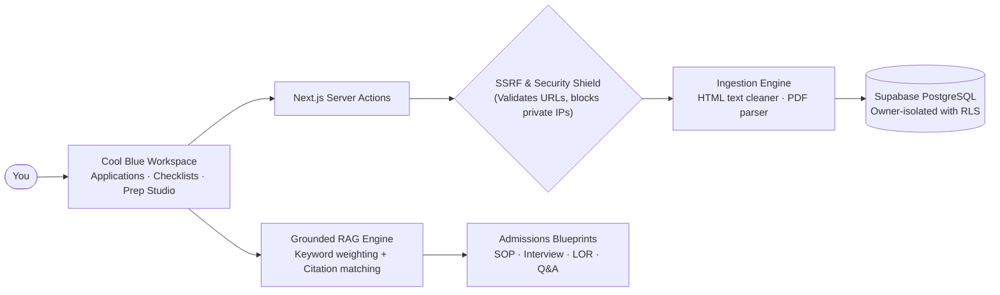
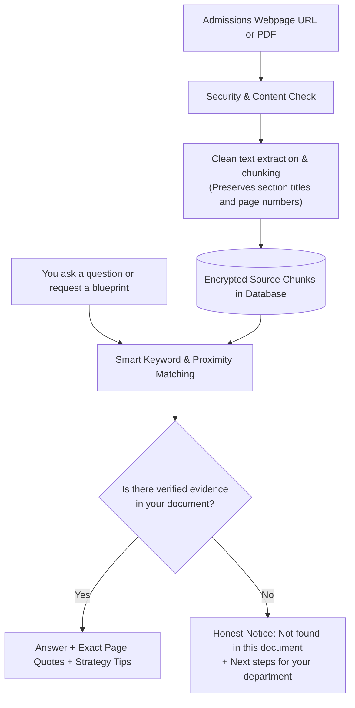

<div align="center">

# Abroad Application Hub 🌍

### Track study-abroad deadlines, ingest official university guidelines, and generate tailored prep blueprints — strictly backed by verified evidence.


[🚀 **Visit Live App**](https://abroad-application-hub.vercel.app)  ·  [Getting started](#getting-started)  ·  [How it works](#how-it-works)  ·  [Honest by design](#honest-by-design)

</div>

---

## In plain English

Applying to universities and scholarships abroad is overwhelming. Admissions rules are scattered across 40-page PDFs, university portals, and embassy notices. Deadlines are easy to miss, and generic advice from search engines often mixes up different degree levels, visa tracks, or requirements.

**Abroad Application Hub** is a personal workspace that keeps your study-abroad journey organized, factual, and stress-free.

Add an application (or watch a program that hasn't opened yet), attach its official webpage or PDF guidelines, and it:

1. **tracks confirmed deadlines and prospective openings** on a clean, visual timeline with automated countdowns and nudge alerts,
2. **reads your official source documents** and pulls out real criteria without overwriting your personal notes,
3. **answers your admissions questions** (such as language test scores, GPA minimums, or eligibility rules) quoting the exact page and source text,
4. **generates tailored blueprints** for your Statement of Purpose (SOP), interview preparation, and recommendation letters (LOR) shaped around your target program's actual requirements.

When a requirement is missing from your document, it says so openly instead of making up dates or guessing rules.

> ⚠️ Abroad Application Hub is a preparation and organization workspace, **not an admissions office**. Always double-check final submission dates on your university's official portal.

---

## Table of contents
- [What you can do](#what-you-can-do)
- [What this project demonstrates](#what-this-project-demonstrates)
- [How it works](#how-it-works)
- [Honest by design](#honest-by-design)
- [How well does it work?](#how-well-does-it-work)
- [Tech stack](#tech-stack)
- [Getting started](#getting-started)
- [Troubleshooting](#troubleshooting)
- [Project structure](#project-structure)
- [Challenges and what I learned](#challenges-and-what-i-learned)
- [Limitations and next steps](#limitations-and-next-steps)
- [Glossary](#glossary)

---

## What you can do

| Feature | You do this | You get this |
|---|---|---|
| 🎯 **Dual-Mode Application Tracker** | Add an open program or an upcoming cycle | Live deadline countdowns, status tags (*Preparing*, *Submitted*, *Accepted*), and clean organization between active applications and your **Intake Watchlist** |
| 🔔 **Opening Reminders & Nudges** | Set an estimated launch date for a program that isn't out yet | Watchlist reminders with smart dashboard nudge alerts when the portal opening window arrives, plus 1-click conversion into an active application |
| 📄 **Official Source Ingestion** | Paste an admissions link or upload a prospectus PDF | Safe text extraction stored strictly in your account with section titles, page markers, and document hashing |
| 💬 **Grounded Q&A** | Ask questions like *"What is the language score required?"* or *"What is the GPA cutoff?"* | Factual answers with clickable page citations and direct quotes, separated from coaching tips |
| 📝 **SOP Blueprint Studio** | Click **SOP Blueprint** | A 4-pillar narrative structure tailored to your chosen program's focus areas, research tracks, and evaluation criteria |
| 🎤 **Interview Prep Studio** | Click **Interview Prep** | Selection stage breakdowns (screening, committee, faculty) and 5 high-yield admissions questions with winning response strategies |
| ✉️ **LOR Strategy Brief** | Click **LOR Strategy** | A referee selection guide, quantified evidence criteria (e.g. class ranking), and an official envelope/letterhead briefing kit for your professors |
| 🔒 **Privacy & Data Freedom** | Click **Export Data** or **Delete Account** in Settings | 1-click offline JSON backup of all your applications, notes, and milestones, or permanent account erasure under strict database isolation |

---

## What this project demonstrates

| Area | What was built |
|---|---|
| **Human-in-the-Loop AI** | AI suggestions (dates, requirements) never overwrite your data silently; you review and approve every extracted item |
| **Grounded Retrieval (RAG)** | Smart keyword classification and sentence co-occurrence that prioritizes specific terms (tests, GPAs, apostilles) over generic filler text |
| **Strict Evidence Abstention** | If your attached prospectus doesn't state a requirement, the system abstains honestly rather than hallucinating false dates |
| **Security & SSRF Defense** | Multi-layer server-side protection on web ingestion: DNS resolution checks, private IP blocking, stream size caps, and mime-type verification |
| **Row-Level Security (RLS)** | PostgreSQL policies ensure complete owner isolation; no user can ever query or view another user's documents or applications |
| **Clean Glassmorphism UI** | A tailored Cool Blue frosted glass design system with backdrop blur, ambient color glow, and accessible contrast |
| **Zero-Cost Deployment** | Fully functional without paid third-party subscriptions; works with free-tier Supabase, Next.js on Vercel, and optional Gemini free tier |
| **Automated Testing** | 34 automated unit and integration tests covering security, grounding, auth validation, and intake workflows |

---

## How it works



### How an admissions document turns into verified preparation



---

## Honest by design

When preparing high-stakes university or visa applications, incorrect information is worse than no information. This project follows strict rules:

- **No silent overwrites.** Ingesting a university page will suggest deadlines and required documents, but it will never erase or change what you typed manually.
- **Evidence or abstention.** If your document does not contain an answer (for example, if a scholarship summary does not list specific departmental language cutoffs), the system clearly says so and advises where to look instead of inventing scores.
- **Separation of facts and coaching.** Official facts cited from your document are displayed with distinct badges and page tags, separate from general strategic coaching advice.
- **No biased hardcoding.** All text inputs, placeholders, and blueprints work universally for any degree level (Bachelor's, Master's, PhD) or country, without favoring specific programs.
- **Your data stays yours.** Every database query enforces Row Level Security based on your encrypted session. You can download all your data in one click or permanently delete your account at any time.

---

## How well does it work?

The test suite runs 34 automated checks on every build, verifying security, grounding accuracy, and isolation.

| Test Category | What is tested | Result |
|---|---|---|
| **RAG Grounding & Abstention** | Rejects ungrounded queries; extracts accurate page citations; keeps facts separate from coaching | ✅ Passed |
| **Tokenization & Term Specificity** | Accurately isolates test acronyms (`topik`, `ielts`, `gre`, `gpa`) from common words | ✅ Passed |
| **SSRF Web Protection** | Blocks loopback (`127.0.0.1`), private LANs (`192.168.x.x`, `10.x.x.x`), cloud metadata (`169.254.169.254`), and invalid protocols | ✅ Passed |
| **Database Row Level Security** | Verifies RLS policies across all tables (`applications`, `sources`, `source_chunks`, `opening_reminders`) | ✅ Passed |
| **Authentication Validation** | Enforces email formats, minimum password lengths, and safe session callbacks | ✅ Passed |
| **End-to-End Walkthrough** | Tests application creation, watchlist reminders, document linking, and intake rollovers | ✅ Passed |

---

## Tech stack

| Part | Tool | Why it was chosen |
|---|---|---|
| **Framework** | Next.js 15 (App Router) | Modern server components, fast routing, and clean Server Actions |
| **Frontend** | React 19 + Tailwind CSS | Fluid reactive state, custom frosted glass styling, responsive layout |
| **Typography** | Manrope & DM Sans | Clean, legible font pairing designed for dense information dashboards |
| **Backend & Database** | Supabase (PostgreSQL) | Native authentication, instant relational data, and Row Level Security |
| **Document Processing** | Node.js stream parsing & `pdf-parse` | Extracts clean text and page numbers from official prospectuses |
| **Security Shield** | Node.js `dns` & `ipaddr.js` | Prevents SSRF attacks by inspecting resolved network addresses before fetching |
| **AI Synthesis** | Deterministic RAG + Google Gemini Free Tier | Works 100% out of the box with zero external cost; optional model synthesis |
| **Testing** | Vitest | Fast, modern test runner validating application logic and security constraints |

---

## Getting started

Follow these simple steps to run the project locally on your machine.

### What you need:
* **Node.js** (v18.18 or newer) — [Download here](https://nodejs.org/)
* A free **Supabase** account — [Sign up here](https://supabase.com)

---

### Step 1: Clone the repository
```bash
git clone https://github.com/anamta-karim/abroad-application-hub.git
cd abroad-application-hub
```

### Step 2: Install dependencies
```bash
npm install
```

### Step 3: Configure your environment variables
Create a `.env.local` file in the root folder:
```bash
# On Windows (PowerShell):
Copy-Item .env.example .env.local

# On macOS / Linux:
cp .env.example .env.local
```

Open `.env.local` in your editor and add your Supabase details (found in your Supabase Dashboard under **Project Settings &rarr; API**):
```ini
NEXT_PUBLIC_SUPABASE_URL=https://your-project.supabase.co
NEXT_PUBLIC_SUPABASE_ANON_KEY=your-anon-key-here
NEXT_PUBLIC_APP_URL=http://localhost:3000

# Optional: Add your free Google Gemini API key for enhanced conversational synthesis
# GEMINI_API_KEY=your-gemini-key-here
```

### Step 4: Set up the database
In your Supabase project dashboard, click **SQL Editor** &rarr; **New query**, and run the two migration scripts in this order:
1. Copy and run [`supabase/migrations/20261101000000_init_schema.sql`](supabase/migrations/20261101000000_init_schema.sql)
2. Copy and run [`supabase/migrations/20261102000000_opening_reminders.sql`](supabase/migrations/20261102000000_opening_reminders.sql)

### Step 5: Start the app
```bash
npm run dev
```
Open **[http://localhost:3000](http://localhost:3000)** in your browser!

### Step 6: Run the tests
```bash
npm test
```
All 34 security, grounding, and isolation tests will run locally.

---

## Troubleshooting

| Problem | What to do |
|---|---|
| **Login or Signup gives a redirect error** | Go to your Supabase Dashboard &rarr; **Authentication &rarr; URL Configuration &rarr; Redirect URLs** and add `http://localhost:3000/**` (or your live Vercel URL `https://your-app.vercel.app/**`) |
| **"Failed to fetch official URL" during ingestion** | The website may be blocking automated scrapers, or the address might be private/internal. Upload the prospectus as a PDF instead |
| **Webpage is missing sections** | Some university portals render content purely via JavaScript. Use the **Upload PDF** option for 100% complete guideline extraction |
| **"Could not find verified evidence" in Q&A** | This means the exact topic was not mentioned in the attached document. Check if the university has a separate department annex or language policy PDF |
| **Port 3000 is already in use** | Run `npm run dev -- -p 3001` to start the app on another port |

---

## Project structure

```
abroad-application-hub/
├── app/                              # Next.js 15 App Router pages & actions
│   ├── app/                          # Authenticated workspace
│   │   ├── applications/             # Application details, new, and edit forms
│   │   │   ├── [id]/                 # Single application overview & source manager
│   │   │   │   └── rag/              # Server Actions for Q&A and blueprints
│   │   │   └── new/                  # Dual-mode application & reminder creator
│   │   ├── settings/                 # Account deletion & JSON data export
│   │   └── page.tsx                  # Main dashboard (Kanban deck, nudge banners)
│   ├── auth/callback/                # Supabase authentication redirect handler
│   ├── login/ & signup/              # Auth forms
│   └── page.tsx                      # Public landing page
├── components/                       # UI components (Cool Blue Glassmorphism)
│   ├── ApplicationDeck.tsx           # Multi-tab application tracker & watchlist
│   ├── ApplicationPrepHub.tsx        # Grounded Prep Studio, Q&A, and markdown viewer
│   ├── NewApplicationForm.tsx        # Dual-mode open vs. reminder form
│   ├── OpeningNudgeBanner.tsx        # Automated dashboard intake alerts
│   └── OpeningReminderModal.tsx      # Quick watchlist reminder modal
├── lib/                              # Core engines
│   ├── ingestion/                    # SSRF defense, HTML parser, and PDF chunker
│   ├── rag/                          # Grounded retrieval engine & blueprint synthesis
│   └── supabase/                     # Browser and server Supabase clients
├── supabase/migrations/              # SQL schema, RLS policies, and triggers
├── tests/                            # Automated test suite (Vitest)
└── types/database.ts                 # TypeScript database interfaces
```

---

## Challenges and what I learned

| Challenge | How it was solved |
|---|---|
| **Generic bag-of-words retrieval failed on specific questions** | When a user asked *"what is the TOPIK requirement"*, a document with many repetitions of the word *"required"* outscored chunks that actually had *"TOPIK"*. I added an admissions keyword classifier that gives rare terms like `topik`, `ielts`, or `gpa` a heavy score boost. |
| **Preventing SSRF vulnerabilities when users submit URLs** | Fetching arbitrary user-submitted URLs can expose internal networks or cloud metadata. I built an SSRF guard that resolves DNS before fetching, rejects private IP ranges (`127.0.0.1`, `10.x.x.x`), and strictly validates protocols. |
| **Balancing upcoming intakes with active applications** | Users often look at programs that won't open for months. Forcing them to enter a fake deadline caused confusion. I separated entries into **Live Applications** (with verified deadlines) and **Opening Reminders** (with expected dates and automated nudge alerts). |
| **Unescaped HTML entities in modern JSX** | Special symbols like `&nearr;` can render as raw code in client components. Replaced raw HTML entities with clean Unicode symbols and SVGs for a polished interface. |
| **Zero-cost RAG without mandatory paid API keys** | Relying solely on paid AI APIs causes rate limit failures and excludes free-tier users. I engineered a deterministic grounded synthesis engine that generates structured blueprints directly from source chunks, with an optional Gemini free-tier layer. |

---

## Limitations and next steps

**Current Limitations:**
* **JavaScript-Heavy Portals**: Web ingestion extracts static server-rendered HTML. Single-page applications that load content purely on the client should be uploaded via their PDF guidelines.
* **Scanned Image PDFs**: Prospectuses saved as pure images without a text layer cannot be parsed by text extractors without an OCR engine.
* **Document Currency**: The system reflects the exact guidelines you attach; if a university updates its requirements mid-cycle, you should attach the updated document.

**Next Steps:**
* Optical Character Recognition (OCR) for scanned embassy forms and printed certificates.
* Multi-file synthesis across linked degree programs and partner scholarship awards.
* Google Calendar and iCal sync for upcoming deadlines and opening alert dates.

---

## Glossary

| Term | Meaning |
|---|---|
| **Intake** | The academic period when a university admits students (e.g., *Fall 2026* or *Spring 2027*). |
| **Opening Watchlist** | A reminder system for programs that haven't launched yet, alerting you when portals open. |
| **Grounding** | Ensuring an AI answer is strictly supported by real sentences in your uploaded document, with zero guessing. |
| **Abstention** | The system's ability to say *"I could not find information regarding this in your source"* when evidence is absent. |
| **SSRF** | Server-Side Request Forgery — a web vulnerability prevented by blocking requests to private internal networks. |
| **RLS** | Row Level Security — a database protection where you can only view and edit your own personal records. |
| **SOP / LOR** | Statement of Purpose (admissions essay) and Letter of Recommendation (referee letter). |

---

<div align="center">

Built by [@anamta-karim](https://github.com/anamta-karim)

</div>
